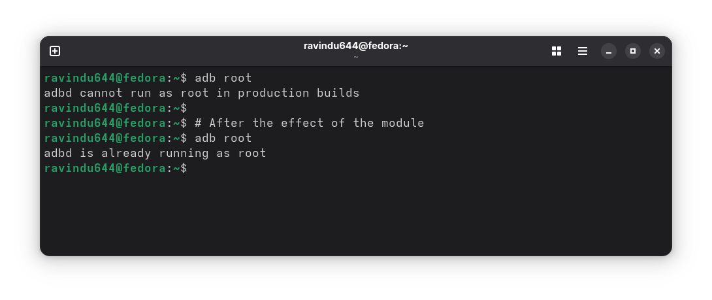

# ADB Root Enabler

A Magisk / KernelSU / APatch module that enables **`adb root`** on production
(`user`-build) Android devices — so `adb root` and a root `adb shell` work
without flashing a `userdebug`/`eng` build.

> Fork of [ravindu644/adb-root-enabler](https://github.com/ravindu644/adb-root-enabler),
> substantially rewritten — see [What's different](#whats-different-from-upstream).

## Compatibility

| | |
|---|---|
| **Root** | Magisk (primary), KernelSU, APatch |
| **Arch** | `arm64-v8a`, `armeabi-v7a`, `x86`, `x86_64` (auto-detected at install) |
| **Android** | 10+ |

> Verified on Magisk. KernelSU/APatch ship the required `resetprop`/`magiskpolicy`
> too, but this fork hasn't been tested there yet.

## Install & use

1. Flash the ZIP in your root manager and **reboot**.
2. From your PC:
   ```sh
   adb root       # adbd restarts as root
   adb shell      # root shell
   ```
   To undo: disable/remove the module and reboot.

By default it applies **automatically on every boot** — nothing to tap.



### Configuration

- **Boot toggle** — `/data/adb/modules/adb-root-enabler/enable_boot_service`:
  - `PATCH_ON_BOOT=1` — patch automatically on boot (**default**).
  - `PATCH_ON_BOOT=0` — do nothing on boot; enable manually instead.
- **Action button** — in the Magisk app, open the module and tap the action
  button to enable ADB root immediately, no reboot required.

## How it works

On boot (or on action-button tap) the module runs [`apply_adb_root`](functions.sh):

1. **Sets the props** that gate root adb, using the bundled Rust
   [resetprop-rs](https://github.com/Enginex0/resetprop-rs): `ro.secure=0`,
   `ro.adb.secure=0`, `ro.debuggable`/`ro.force.debuggable=1`, `service.adb.root=1`,
   the `persist.*` adb props, plus TCP-ADB on `5555` and the Settings "USB debugging"
   globals.
2. Every write is a **stealth write** (`-st`): zeroed serial, no global serial
   bump, no futex wake — so the write doesn't raise the usual serial/futex signals
   another property module would watch for. `persist.*` props are also written
   through to disk (`-p`) so they persist across reboots.
3. **Injects live SELinux rules** with `magiskpolicy` (wrapped in `setenforce 0/1`)
   and restarts `adbd` via `property_service`.
4. A short **re-apply loop** re-runs the above for up to 60s if anything resets
   `ro.secure`, to counter late-boot overrides.

## What's different from upstream

- **Multi-arch** resetprop-rs binaries instead of bundled `magiskpolicy` binaries.
- **Enabled on boot by default** (upstream ships it disabled).
- **Stealth + persist** property writes via resetprop-rs, instead of upstream's
  Magisk `resetprop`.
- 60s re-apply loop to counter late-boot prop resets.
- Shared logic factored into `functions.sh`; adds `updateJson` and a CI release workflow.

## Security note

This intentionally weakens ADB security: with `ro.secure=0` / `ro.adb.secure=0`,
anything with ADB access gets a root shell. Only enable it on devices you control
and trust.

## Building & releasing

- **Local:** `./build_zip.sh` (needs `rsync` + `zip`) → `adb-root-enabler.zip`.
- **CI:** [`.github/workflows/build.yml`](.github/workflows/build.yml) builds the ZIP
  and attaches it to a GitHub Release on any `v*` tag:
  ```sh
  git tag v2 && git push origin v2
  ```
  Manual runs (Actions tab) produce a downloadable build artifact instead.

When cutting a release, bump `version`/`versionCode` in `module.prop`, mirror them
in `update.json`, add a `CHANGELOG.md` entry, and tag to match (`vN`). `updateJson`
then delivers in-app update notifications.

## Credits

- [ravindu644/adb-root-enabler](https://github.com/ravindu644/adb-root-enabler) — original module this is forked from
- [Enginex0/resetprop-rs](https://github.com/Enginex0/resetprop-rs) — bundled Rust `resetprop` binaries (v0.6.0)
- [XDA Forum comment](https://xdaforums.com/t/enable-adb-root-from-shell.4298567/post-90167637) — method inspiration
- [Magisk](https://github.com/topjohnwu/Magisk) — `magiskpolicy` tool

## License

[GPL-2.0](LICENSE)
